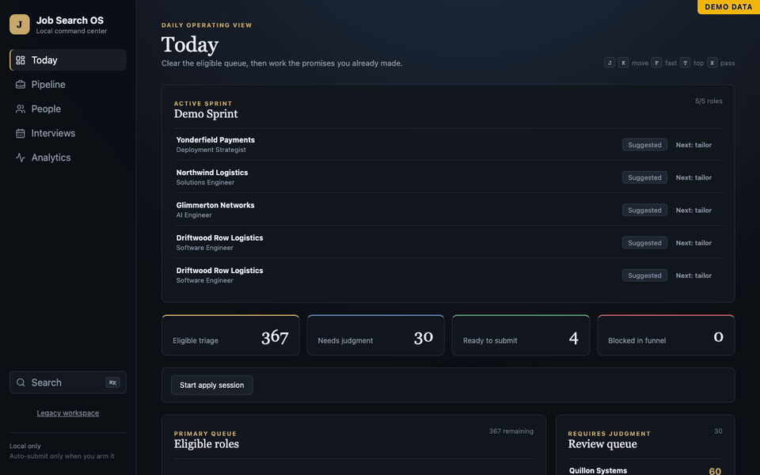
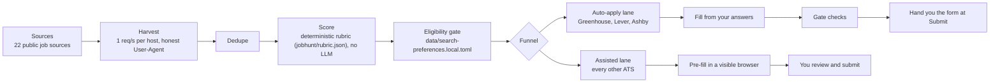
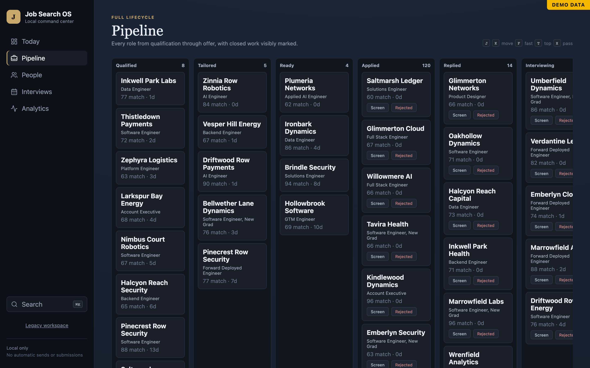
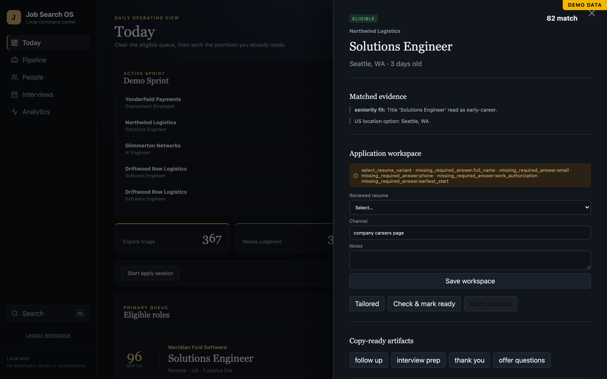
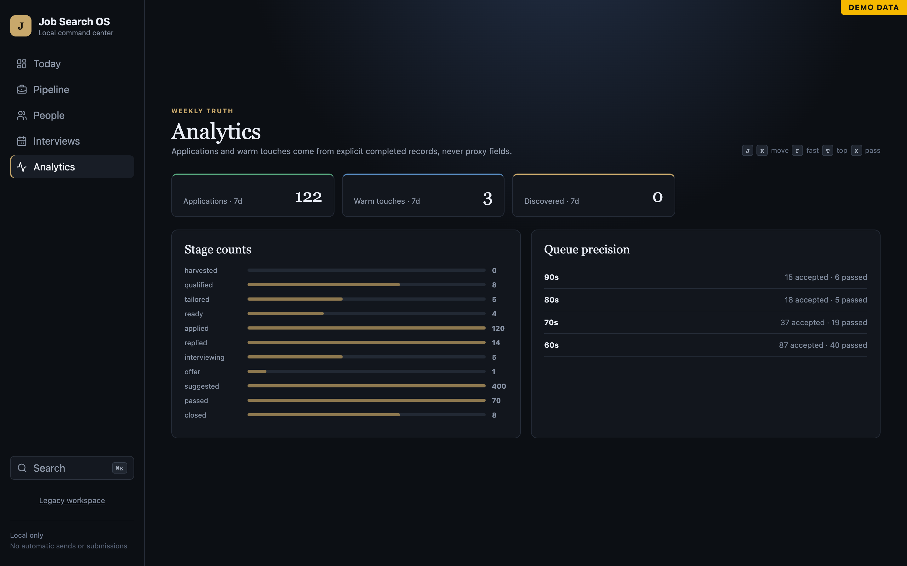

# job-autopilot

**A local-first job-search engine that harvests postings from public ATS APIs, scores them against your profile, and fills Greenhouse, Lever and Ashby applications under hard caps.**


[](https://github.com/ed-da-goat/job-autopilot/actions/workflows/test.yml)




## Numbers from the author's own run

As of 2026-11-06, one real search produced:

| Postings harvested | Postings scored | Sources |
| ---: | ---: | ---: |
| 579,162 | 146,138 | 22 |

## How it works



**Auto-apply lane.** Greenhouse, Lever and Ashby only. The lane tailors your resume, fills the form from your stored answers, and runs a submit gate that blocks on sign-in walls, CAPTCHAs, human checks and required fields it cannot answer. Until you run `jobhunt autoapply arm` it is dry: it fills and gates but never hands anything off. Once armed, it leaves each filled form open in a visible browser tab at the Submit button. The pipeline never clicks Submit itself; you do. Caps: 25 forms a day by default (configurable up to 100), 3 per company per 30 days.

**Assisted lane.** Every other ATS. `jobhunt apply` and `jobhunt apply-queue` pre-fill the hosted form in a visible browser, and you review and submit.

## Screenshots

| Pipeline | Posting detail | Analytics |
| :---: | :---: | :---: |
|  |  |  |

## Try it in 60 seconds

```bash
git clone https://github.com/ed-da-goat/job-autopilot.git && cd job-autopilot
uv sync
make demo
```

Then open <http://127.0.0.1:8787>. The demo runs on a synthetic database (`data/demo.db`) with a **DEMO DATA** badge. It needs no profile, no API keys, no network and no LLM, and it never touches your real database.

Prerequisites:

- [uv](https://docs.astral.sh/uv/) (Python 3.12+ is installed for you)
- Node and npm: `make demo` builds the web UI on first run
- For real applications only: Google Chrome (the apply browser) and LibreOffice (`brew install --cask libreoffice`; it turns the tailored resume into a PDF), and the Claude Code CLI (`claude`) signed in to a Claude subscription, which auto-apply uses to tailor each resume. `jobhunt doctor` checks all three.
- macOS, only if you want launchd scheduling; the rest is plain Python

## Make it yours

1. **Run the setup wizard.**

   ```bash
   uv run python -m jobhunt init     # copies the templates, asks ~9 questions, runs the doctor
   uv run python -m jobhunt doctor   # re-check any time
   ```

   `init` copies every template to its gitignored local name, writes your answers into them, loads your form answers into the database, and puts the example resume at `data/resume.local.docx`. It never overwrites an existing file without `--force`; `--non-interactive` takes every answer as a flag. The doctor fails on any `[FILL]` left and warns while example-persona data is still in place.

   Everything below lives in `data/search-preferences.local.toml`. The fields that matter: `candidate_name` and `contact_email` (output file names and the HTTP User-Agent), `target_roles`, `allowed_countries` and `allow_us_remote`, `max_eligible_years` and `review_years_max`, `blocked_title_terms` and `review_title_terms` (titles dropped or sent to a review queue), and the `[[city_tiers]]` location ranking.

   The `[lane]` table decides which postings auto-apply works on. The default preset, `target_roles`, takes titles matching your `target_roles` (or `include_title_terms`), drops `exclude_title_terms` (the template excludes senior, staff, principal, lead, manager, contract and part-time roles), keeps configured cities and US-remote roles, and can require JD keywords (`require_jd_terms`) or a `min_score`. `preset = "finance_ai"` switches to the author's original finance × AI routing.

   The `[standing_answers]` table holds the answers auto-apply may give for you: earliest start, salary, travel, current employer, school and similar. It **fails closed**: delete any key you do not want answered, and an unset answer is never guessed. The field is asked and the form is handed to you instead. Every value must be true of you.

   `[autoapply]` sets the caps: `daily_cap` (default 25) and `per_company_30d` (default 3), both hard-limited to 100.

2. **Replace the example persona with you.**

   - `PROFILE.md`: your positioning and work history.
   - `data/facts.local.md`: the only source drafted essay answers may draw on.
   - `data/answers.local.md`: your standard form answers. After editing, reload them with `uv run python -m jobhunt apply-profile import`.
   - `data/resume.local.docx`: your resume, in the same layout as `examples/resume.example.docx` (it needs a `SKILLS/INTERESTS` section of `Label:<tab>items` lines). Set `JOBHUNT_RESUME_TEMPLATE` to point somewhere else.
   - `data/apply_packs/finai/master.rm.json`: the structured master resume tailoring rewrites from; start from `examples/master.example.rm.json`.
   - Optional: copy `data/rubric.local.example.json` to `data/rubric.local.json` to re-weight scoring for your search (the shipped `jobhunt/rubric.json` leans toward fintech, applied AI and founder/startup roles; its `founder_leverage` component weighs 25).

3. **Build your database and run the pipeline.**

   ```bash
   make seed       # import companies from data/seed_companies.md
   make harvest    # sweep the sources (polite: 1 request/s per host)
   make score      # score active postings against jobhunt/rubric.json
   make counts     # row counts per source
   make ui         # the web UI at http://127.0.0.1:8787
   ```

   Grow the company list with `jobhunt seed-expand` and `jobhunt discover`.

4. **Run the daily routine.** `make daily` does the full sweep: harvest, rescore, suggest, digest, notify. `make daily-dry` skips the harvest. `make report` prints funnel counts and next actions due, and `jobhunt digest --print` shows today's digest.

5. **Apply.** `make apply-queue` pre-fills the top of the queue in one visible browser, one tab per posting.

## Turning on auto-apply

1. **Dry runs first.** `make autoapply` (`jobhunt autoapply run`) is dry until armed: it tailors, fills, gates and screenshots, and records the result. Arming is refused until 10 dry runs are recorded (`dry_run_quota`), with at most 4 per ATS and 1 per company in a dry run.
2. **Review them.** Read the daily digest under `data/autoapply/` and check `jobhunt autoapply status`. Anything the gate blocked is listed with the reason.
3. **Arm.**

   ```bash
   uv run python -m jobhunt autoapply arm --approved "reviewed 10 dry runs, go"
   ```

   The `--approved` text is stored with the arm time. `jobhunt autoapply disarm` returns to dry mode at any point.
4. **Caps** (`[autoapply]` in your local config): 25 forms per day and 3 per company per rolling 30 days by default, never above 100; 5 failures or 15 blocks in a row stops the run. A form counts when it is filled, and a handed-off form counts like a click. Blocked postings are not retried for 7 days.
5. **Schedule it (macOS).** `scripts/install-launchd.sh autoapply` writes the plist into `~/Library/LaunchAgents` and **prints** the `launchctl` commands without running them. `make schedule-install-autoapply` does the install and load in one step, and only once `jobhunt autoapply status --require-armed` passes. The same script handles `daily` and `watch`.

## Guardrails

- Public endpoints only: ATS APIs, RSS feeds, and listing pages that allow crawling in `robots.txt`. Nothing is scraped behind a login. The submit gate blocks any page showing a password field or a "create an account" wall.
- It never creates accounts and never enters passwords.
- It never solves or evades CAPTCHAs. A CAPTCHA, reCAPTCHA frame or emailed verification code is a human check, and the posting goes to your needs-you list.
- Auto-apply runs only on Greenhouse, Lever and Ashby. It does not drive LinkedIn or Indeed; job-alert emails are parsed only if you set up the optional Gmail ingester.
- EEO and demographic questions get "Decline to self-identify" and nothing else.
- Hard caps per day and per company, and `jobhunt autoapply disarm` to go back to dry mode at any time.
- Personal data stays on disk in gitignored files: `PROFILE.md`, `data/*.local.*`, `data/autoapply/`, `data/apply_packs/`, `data/*.db`, and your resume.

## LLM drafting

Harvest, scoring, dedupe, the funnel and the UI need no LLM. Auto-apply resume tailoring does: it always runs through the `claude` CLI (Claude Code on your own Claude subscription), and `jobhunt doctor` warns when the CLI is missing. Drafting (tailored resumes, cover letters, essay answers) goes through `jobhunt/connectors`:

- `claude_cli`: runs the `claude` CLI on your own subscription, with no metered API credits. Select it with `JOBHUNT_LLM_BACKEND=claude_cli`.
- `openrouter`: metered. Gated by `SPEND_OK=1` plus `OPENROUTER_API_KEY`, a daily cap of $1.00 and a per-run cap of $0.25 (`jobhunt/spend.py`). Without both variables the call is refused before any network request.
- Local Ollama: `make ui-local` points the same client at `http://localhost:11434/v1`. It costs nothing and skips the spend gate.

## Project layout

```text
jobhunt/              CLI (cli.py), harvest, scoring, funnel, eligibility
  sources/            22 source adapters (greenhouse, lever, ashby, workday, ...)
  connectors/         claude_cli, openrouter (also serves local Ollama)
  apply_assist/       form detection, field solver, fill, submit gate and guard
  autoapply.py        the Greenhouse/Lever/Ashby lane
  rubric.json         scoring weights
  web/                FastAPI app and React frontend (web/frontend)
data/                 templates and seed list; your local files are gitignored
launchd/, scripts/    macOS schedule templates and installer
tests/                pytest suite
daily.py, watch.py    scheduled entry points
```

## Testing

```bash
make test       # about 8.4k tests, network-free, about 5 minutes (CI runs them on every push)
make ui-test    # frontend tests (vitest)
```

## Known limits

- The shipped scoring rubric and the seed company list (`data/seed_companies.md`) come from the author's fintech and applied-AI search, so a pure software search scores lower out of the box. Scores only rank the queue; use `data/rubric.local.json` and your own seed list to retune.
- The apply lanes drive Google Chrome through Playwright, so Chrome must be installed.

- Handoff mode needs you at the machine: the forms wait in browser tabs for your click.
- Scheduling is macOS-only (launchd). Everything else runs anywhere Python and Node do.

## Responsible use

Apply to roles you would actually take. The caps exist to protect you and the employers on the other end. You are responsible for every answer submitted in your name, so keep `[standing_answers]` and `facts.local.md` true.

## License

[MIT](LICENSE)
